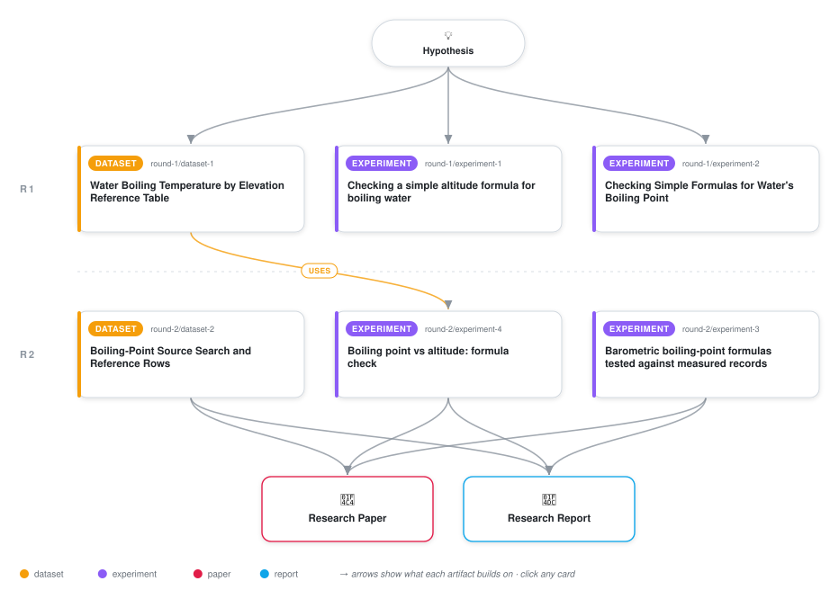

# Barometric Boiling Formula: Structural Error at 4000 m

<div align="center">

<a href="https://cdn.jsdelivr.net/gh/ai-inventor-papers/ai-invention-afc680-barometric-formula-predicts-waters@main/workflow.svg">
<picture>
  <source media="(prefers-color-scheme: dark)" srcset="workflow-dark.svg">
  
</picture>
</a>

<sub>🖱️ <b><a href="https://cdn.jsdelivr.net/gh/ai-inventor-papers/ai-invention-afc680-barometric-formula-predicts-waters@main/workflow.svg">Open the interactive diagram</a></b> — every card links to its artifact folder.</sub>

</div>

> **TL;DR** — We tested how far a simple isothermal barometric formula departs from a reference boiling curve (IAPWS-IF97) on a 0 to 4,000 m grid, comparing it with the lapse-rate form. The structural error reaches 0.588 K at 4,000 m, which is 0.088 K above a pre-set 0.5 K target; it grows with altitude. This is a single exploratory, reference-only screen with no interval and no measured data, so it does not show how the formula compares with measured boiling points, which could not be tested because no measured record met the acceptance criteria.

<details>
<summary>Full hypothesis</summary>

A simple barometric formula, coupled to the IAPWS-95 water saturation curve, predicts measured water boiling temperatures from sea level to 4,000 m to within about 0.3 °C when the measured station pressure is used, and to within about 0.6 °C from altitude alone with the standard atmosphere. This is not yet tested against measurements. The only executed evidence is a model-to-reference comparison, which shows the isothermal-versus-lapse-rate structural term reaches 0.33 K at 3 km and 0.59 K at 4 km, above the 0.5 K structural target. At 4 km the structural term alone therefore uses nearly all of the 0.6 K altitude-only budget, so the claim that weather dominates the residual is open. The next iteration tests the full chain against published measured boiling records (site elevation, station pressure, observed boiling temperature) from sources not yet fetched, such as NOAA GHCN-Daily station pressure and handbook steam tables, with a held-out set of sites. Confirmed if the station-pressure residual RMS is at or below 0.3 K across reliable sites up to 4,000 m; disconfirmed if several reliable sites exceed 0.5 K.

</details>

[](https://ai-inventor-papers.github.io/ai-invention-afc680-barometric-formula-predicts-waters/) [](https://ai-inventor-papers.github.io/ai-invention-afc680-barometric-formula-predicts-waters/interactive.html)

[](https://cdn.jsdelivr.net/gh/ai-inventor-papers/ai-invention-afc680-barometric-formula-predicts-waters@main/paper.pdf) [](https://cdn.jsdelivr.net/gh/ai-inventor-papers/ai-invention-afc680-barometric-formula-predicts-waters@main/report.pdf) [](https://cdn.jsdelivr.net/gh/ai-inventor-papers/ai-invention-afc680-barometric-formula-predicts-waters@main/exec_summary.pdf) [](https://cdn.jsdelivr.net/gh/ai-inventor-papers/ai-invention-afc680-barometric-formula-predicts-waters@main/round-2/report.pdf) [](https://github.com/ai-inventor-papers/ai-invention-afc680-barometric-formula-predicts-waters/tree/main/paper_latex)

**Round reports:** [Round 1](https://cdn.jsdelivr.net/gh/ai-inventor-papers/ai-invention-afc680-barometric-formula-predicts-waters@main/round-1/report.pdf) · [Round 2](https://cdn.jsdelivr.net/gh/ai-inventor-papers/ai-invention-afc680-barometric-formula-predicts-waters@main/round-2/report.pdf)

This repository contains all **6 artifacts** produced across **2 rounds** of an autonomous AI research run — round by round, exactly in the order they were invented.

## Round 1

| Artifact | Type | Demo | Source | Builds on |
|----------|------|------|--------|-----------|
| **[Water Boiling Temperature by Elevation Reference Table](https://github.com/ai-inventor-papers/ai-invention-afc680-barometric-formula-predicts-waters/tree/main/round-1/dataset-1)** | [](https://github.com/ai-inventor-papers/ai-invention-afc680-barometric-formula-predicts-waters/tree/main/round-1/dataset-1) | [](https://colab.research.google.com/github/ai-inventor-papers/ai-invention-afc680-barometric-formula-predicts-waters/blob/main/round-1/dataset-1/demo/data_code_demo.ipynb) | [](https://github.com/ai-inventor-papers/ai-invention-afc680-barometric-formula-predicts-waters/tree/main/round-1/dataset-1/src) | — |
| **[Checking a simple altitude formula for boiling water](https://github.com/ai-inventor-papers/ai-invention-afc680-barometric-formula-predicts-waters/tree/main/round-1/experiment-1)** | [](https://github.com/ai-inventor-papers/ai-invention-afc680-barometric-formula-predicts-waters/tree/main/round-1/experiment-1) | [](https://colab.research.google.com/github/ai-inventor-papers/ai-invention-afc680-barometric-formula-predicts-waters/blob/main/round-1/experiment-1/demo/method_code_demo.ipynb) | [](https://github.com/ai-inventor-papers/ai-invention-afc680-barometric-formula-predicts-waters/tree/main/round-1/experiment-1/src) | — |
| **[Checking Simple Formulas for Water's Boiling Point](https://github.com/ai-inventor-papers/ai-invention-afc680-barometric-formula-predicts-waters/tree/main/round-1/experiment-2)** | [](https://github.com/ai-inventor-papers/ai-invention-afc680-barometric-formula-predicts-waters/tree/main/round-1/experiment-2) | [](https://colab.research.google.com/github/ai-inventor-papers/ai-invention-afc680-barometric-formula-predicts-waters/blob/main/round-1/experiment-2/demo/method_code_demo.ipynb) | [](https://github.com/ai-inventor-papers/ai-invention-afc680-barometric-formula-predicts-waters/tree/main/round-1/experiment-2/src) | — |

## Round 2

| Artifact | Type | Demo | Source | Builds on |
|----------|------|------|--------|-----------|
| **[Boiling-Point Source Search and Reference Rows](https://github.com/ai-inventor-papers/ai-invention-afc680-barometric-formula-predicts-waters/tree/main/round-2/dataset-2)** | [](https://github.com/ai-inventor-papers/ai-invention-afc680-barometric-formula-predicts-waters/tree/main/round-2/dataset-2) | [](https://colab.research.google.com/github/ai-inventor-papers/ai-invention-afc680-barometric-formula-predicts-waters/blob/main/round-2/dataset-2/demo/data_code_demo.ipynb) | [](https://github.com/ai-inventor-papers/ai-invention-afc680-barometric-formula-predicts-waters/tree/main/round-2/dataset-2/src) | — |
| **[Barometric boiling-point formulas tested against measured re…](https://github.com/ai-inventor-papers/ai-invention-afc680-barometric-formula-predicts-waters/tree/main/round-2/experiment-3)** | [](https://github.com/ai-inventor-papers/ai-invention-afc680-barometric-formula-predicts-waters/tree/main/round-2/experiment-3) | [](https://colab.research.google.com/github/ai-inventor-papers/ai-invention-afc680-barometric-formula-predicts-waters/blob/main/round-2/experiment-3/demo/method_code_demo.ipynb) | [](https://github.com/ai-inventor-papers/ai-invention-afc680-barometric-formula-predicts-waters/tree/main/round-2/experiment-3/src) | — |
| **[Boiling point vs altitude: formula check](https://github.com/ai-inventor-papers/ai-invention-afc680-barometric-formula-predicts-waters/tree/main/round-2/experiment-4)** | [](https://github.com/ai-inventor-papers/ai-invention-afc680-barometric-formula-predicts-waters/tree/main/round-2/experiment-4) | [](https://colab.research.google.com/github/ai-inventor-papers/ai-invention-afc680-barometric-formula-predicts-waters/blob/main/round-2/experiment-4/demo/method_code_demo.ipynb) | [](https://github.com/ai-inventor-papers/ai-invention-afc680-barometric-formula-predicts-waters/tree/main/round-2/experiment-4/src) | <sub><i>uses:</i><br/>[dataset‑1&nbsp;(R1)](https://github.com/ai-inventor-papers/ai-invention-afc680-barometric-formula-predicts-waters/tree/main/round-1/dataset-1)</sub> |

## Repository Structure

Artifacts are grouped by the round of invention that produced them. Each
artifact has its own folder with source code and a self-contained demo:

```
.
├── round-1/                         # One folder per round of invention
│   ├── experiment-1/
│   │   ├── README.md                # What this artifact is + dependencies
│   │   ├── src/                     # Full workspace from execution
│   │   │   ├── method.py            # Main implementation
│   │   │   ├── method_out.json      # Full output data
│   │   │   └── ...                  # All execution artifacts
│   │   └── demo/                    # Self-contained demo
│   │       └── method_code_demo.ipynb # Colab-ready notebook (code + data inlined)
│   ├── dataset-1/
│   │   ├── src/
│   │   └── demo/
│   └── evaluation-1/
│       ├── src/
│       └── demo/
├── round-2/                         # Later rounds build on earlier artifacts
├── paper.pdf                        # Research paper
├── paper_latex/                     # LaTeX source files
├── report.pdf                       # Full internal report — every experiment, table and dead end
├── report_latex/                    # LaTeX source of the report
├── exec_summary.pdf                 # Executive summary of the report, at most four pages
├── chat/                            # Every prompt, response and tool call, per module
├── workflow.svg                     # Artifact dependency diagram (this page's header)
└── README.md
```

## Running Notebooks

### Option 1: Google Colab (Recommended)

Click the "Open in Colab" badges above to run notebooks directly in your browser.
No installation required!

### Option 2: Local Jupyter

```bash
# Clone the repo
git clone https://github.com/ai-inventor-papers/ai-invention-afc680-barometric-formula-predicts-waters
cd ai-invention-afc680-barometric-formula-predicts-waters

# Install dependencies
pip install jupyter

# Run any artifact's demo notebook
jupyter notebook <artifact_folder>/demo/
```

## Source Code

The original source files are in each artifact's `src/` folder.
These files may have external dependencies - use the demo notebooks for a self-contained experience.

---
*Generated by AI Inventor Pipeline - Automated Research Generation*
